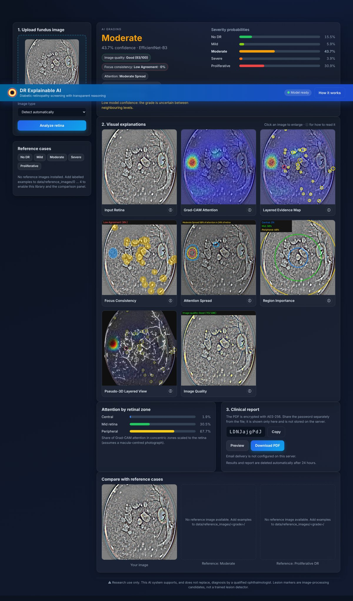
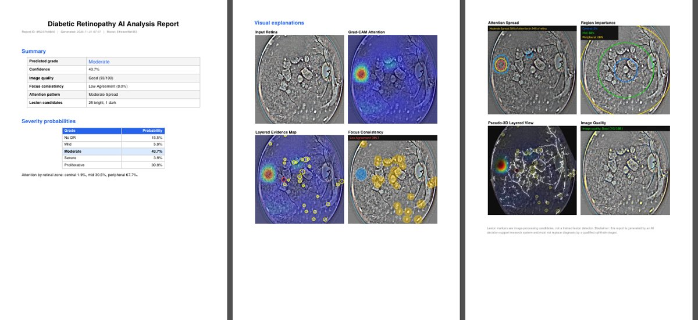

# 🧠 DR Explainable AI System

**Diabetic retinopathy grading from retinal fundus images, with explanations a clinician can check.**

[](https://github.com/kalavalashivaharikowshik/DR-Explainable-AI-System/actions/workflows/ci.yml)


An end-to-end web application that grades diabetic retinopathy (DR) on the international
5-level scale using **EfficientNet-B3**, then shows *why* the model decided as it did:
where it looked, whether that matches visible lesion candidates, which retinal zones mattered
and whether the photograph is good enough to trust. Results can be exported as an
**AES-256 encrypted PDF report** and emailed to a doctor.



---

## Contents

- [Why](#-why)
- [Features](#-features)
- [How it works](#-how-it-works)
- [Quick start](#-quick-start)
- [Deploy to Hugging Face Spaces](#-deploy-to-hugging-face-spaces)
- [Configuration](#-configuration)
- [Training your own model](#-training-your-own-model)
- [Project structure](#-project-structure)
- [API](#-api)
- [Security & privacy](#-security--privacy)
- [Limitations](#-limitations)
- [License](#-license)

---

## 📌 Why

Diabetic retinopathy is a leading cause of preventable blindness, and screening is limited by
the number of ophthalmologists. AI can help triage images, but a bare prediction is hard to
trust in a medical setting. This project pairs the classifier with several complementary
explanations so a reviewer can judge whether the model's reasoning is plausible.

## ✨ Features

| | Feature | What it shows |
|---|---|---|
| 🎯 | **DR grading** | No DR · Mild · Moderate · Severe · Proliferative, with per-grade probabilities |
| 🔥 | **Grad-CAM attention** | Regions that pushed the model towards the predicted grade |
| 🧩 | **Layered evidence map** | Attention + bright (exudate-like) and dark (haemorrhage/microaneurysm-like) lesion candidates + optic disc |
| ✅ | **Focus consistency** | Share of the model's high-attention area that lies on lesion candidates |
| 🌫️ | **Attention spread** | How concentrated attention is (Focused / Moderate / Diffuse), with 25/50/75 % contours |
| 🎯 | **Region importance** | Attention in central (macula), mid and peripheral zones scaled to the retina |
| 🏔️ | **Pseudo-3D layered view** | Vessels, lesions and attention rendered as a shaded relief |
| 📷 | **Image quality** | Blurred, over- and under-exposed areas and a 0–100 quality score |
| 🖼️ | **Reference comparison** | Your image next to labelled examples (optional local library) |
| 📄 | **Encrypted PDF report** | AES-256, random 10-character password shown once, never stored |
| ✉️ | **Email delivery** | Sends the encrypted report; the password is deliberately *not* emailed |

<p align="center">
  
</p>

## ⚙ How it works

```
Upload ─► Preprocess ─► EfficientNet-B3 ─► Grad-CAM (one pass) ─┬─► Lesion candidates ─► Evidence / Consistency
         (crop, CLAHE,   (5-grade         raw attention map     ├─► Region importance & attention spread
          Ben Graham)     probabilities)                         ├─► Pseudo-3D view
                                                                 └─► Image quality ─► Encrypted PDF report
```

* **Same preprocessing as training.** Uploads go through the exact crop → CLAHE → Ben Graham
  → 300 × 300 pipeline used to build the training set (`src/preprocessing/resize_normalize.py`).
  Already-preprocessed images are detected automatically (or chosen manually in the UI).
* **One model pass.** Prediction and Grad-CAM come from a single forward/backward pass; every
  explanation reuses the same raw attention map, so all panels are consistent with each other.
* **Model:** EfficientNet-B3 (ImageNet initialisation) fine-tuned on a unified APTOS, EyePACS and
  Messidor dataset.

## 🚀 Quick start

> The model weights (43 MB) are stored with **Git LFS**. Install it first, or the model file will
> only be a small text pointer.

```bash
git lfs install
git clone https://github.com/kalavalashivaharikowshik/DR-Explainable-AI-System.git
cd DR-Explainable-AI-System

python -m venv .venv && source .venv/bin/activate     # Windows: .venv\Scripts\activate
pip install -r requirements.txt

uvicorn app.backend.main:app --reload
```

Open <http://127.0.0.1:8000>.

**With Docker**

```bash
docker build -t dr-xai .
docker run -p 7860:7860 dr-xai          # open http://localhost:7860
```

**Run the tests**

```bash
pip install -r requirements-dev.txt
pytest
```

## ☁ Deploy to Hugging Face Spaces

The repository deploys itself to a free Hugging Face Space (16 GB RAM, CPU) whenever tests pass
on `main` (`.github/workflows/deploy-hf.yml`).

1. Create a free account at [huggingface.co](https://huggingface.co).
2. Create an access token with **Write** permission: *Settings → Access Tokens → Create new token*.
3. In this GitHub repo open *Settings → Secrets and variables → Actions* and add:
   * secret **`HF_TOKEN`**: the token from step 2 (required)
   * secrets **`SMTP_USER`** / **`SMTP_PASSWORD`**: Gmail address and a Gmail
     [app password](https://myaccount.google.com/apppasswords), to enable email (optional)
   * variable **`HF_SPACE_NAME`**: Space name (optional, default `dr-explainable-ai-system`)
4. Open *Actions → Deploy to Hugging Face Spaces → Run workflow* (or push to `main`).

The app will be live at `https://<hf-username>-dr-explainable-ai-system.hf.space` after the
first build (about 5–10 minutes).

## 🔧 Configuration

All settings are environment variables (see `src/config/config.py`):

| Variable | Default | Purpose |
|---|---|---|
| `DR_MODEL_PATH` | `models/trained/best_model.pth` | Trained weights |
| `DR_RESULTS_DIR` | `outputs/results` | Where analysis images and reports are written |
| `DR_RESULT_TTL_HOURS` | `24` | Results are deleted after this many hours |
| `DR_MAX_UPLOAD_MB` | `15` | Maximum upload size |
| `DR_REFERENCE_DIR` | `data/reference_images` | Optional labelled examples `0/ … 4/` |
| `SMTP_USER`, `SMTP_PASSWORD` | – | Enable email delivery (never commit these) |
| `SMTP_HOST`, `SMTP_PORT`, `SMTP_SENDER` | Gmail SSL | Other SMTP servers |

**Reference library (optional):** put a few labelled images in
`data/reference_images/0` (No DR) … `data/reference_images/4` (Proliferative) to enable the
sidebar library and the comparison panel. Only use images whose licence allows redistribution.

## 🏋 Training your own model

```bash
pip install -r requirements-dev.txt

# 1. dr_unified_v2/{train,val,test}/{0..4}/*.jpg  ->  data/processed/...
python -m src.preprocessing.run_preprocessing --input dr_unified_v2 --output data/processed

# 2. train (class-weighted loss, best checkpoint by quadratic weighted kappa)
python -m src.models.classification.train --epochs 30

# 3. evaluate on the test split (confusion matrix, per-class report, QWK)
python -m src.models.classification.evaluate
```

## 📁 Project structure

```
DR-Explainable-AI-System
├── app
│   ├── backend/main.py            FastAPI app and API routes
│   └── frontend/                  index.html, styles.css, app.js
├── src
│   ├── config/                    settings (env vars) and paths
│   ├── preprocessing/             crop, CLAHE, Ben Graham, shared prepare_image()
│   ├── models/
│   │   ├── classification/        EfficientNet-B3, train.py, evaluate.py
│   │   └── loaders/               ImageFolder data loaders
│   ├── inference/                 predict.py (load-once predictor), pipeline.py
│   ├── explainability/            Grad-CAM, evidence map, focus consistency, regions, spread
│   ├── visualization/             pseudo-3D view, reference comparison
│   ├── quality_assessment/        image quality overlay and score
│   ├── reporting/                 PDF generation and AES-256 encryption
│   ├── email_service/             SMTP delivery
│   └── utils/                     ids, cleanup, logging, metrics
├── models/trained/best_model.pth  trained weights (Git LFS)
├── tests/                         pytest suite (API, security, preprocessing, explainability)
├── scripts/deploy_hf_space.py     Hugging Face deployment helper
├── Dockerfile
└── .github/workflows/             CI and deployment
```

## 🔌 API

Interactive docs are at `/docs` when the server is running.

| Method | Path | Description |
|---|---|---|
| `POST` | `/api/analyze` | multipart `file` (+ optional `preprocessed=auto\|true\|false`) → full analysis JSON |
| `GET` | `/api/results/{id}/{name}.jpg` | One explanation image |
| `GET` | `/api/reports/{id}/report.pdf` | Encrypted PDF (`?download=true` to download) |
| `POST` | `/api/reports/{id}/email` | `{"email": "..."}` sends the report (if SMTP is configured) |
| `GET` | `/api/reference/{grade}` | Reference images for a grade |
| `GET` | `/api/config`, `/api/health` | Frontend settings, model status |

## 🔐 Security & privacy

* Uploaded images are processed in memory and never saved under their original filename.
* Each analysis gets an unguessable 128-bit id; results expire automatically (default 24 h).
* Reports are AES-256 encrypted; no unencrypted copy is kept, and the password is never stored or emailed.
* The email endpoint only accepts a result id and a validated address, and is rate-limited.
* Credentials come only from environment variables or hosting secrets.
* There is no user login: treat a public deployment as a demo and do not upload identifiable patient data.

## ⚠ Limitations

* Lesion markers come from classical image processing (adaptive thresholds and shape filters),
  **not** from a trained lesion-segmentation model; faint lesions can be missed and reflections flagged.
* Retinal zones assume a macula-centred photograph.
* Grad-CAM resolution is limited by the network (10 × 10 feature map, upsampled).
* The model has not been clinically validated.

## 👨‍💻 Author

**Kowshik** – AI / Computer Vision research project

## 📜 License

[MIT](LICENSE). This software is for research and education only and is **not a medical device**.
It assists, and does not replace, diagnosis by a qualified ophthalmologist.
